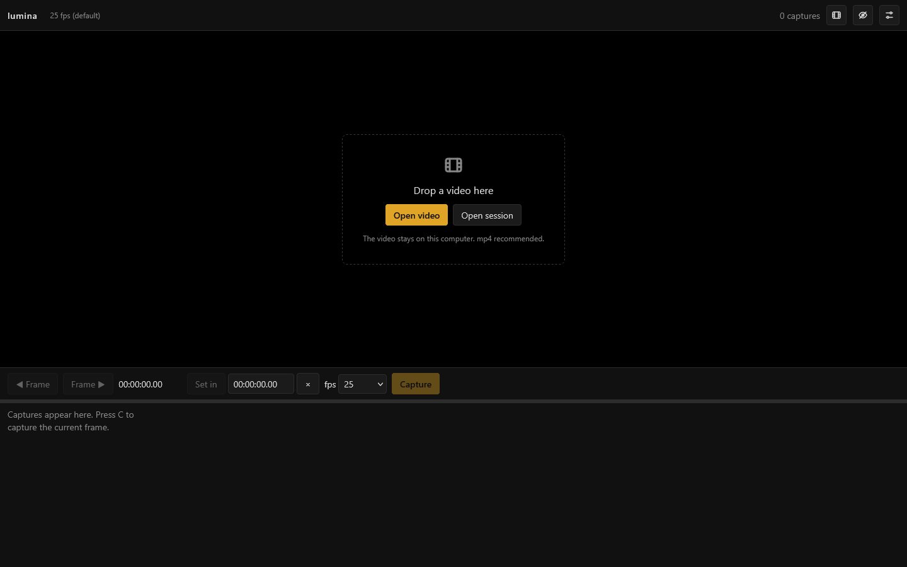
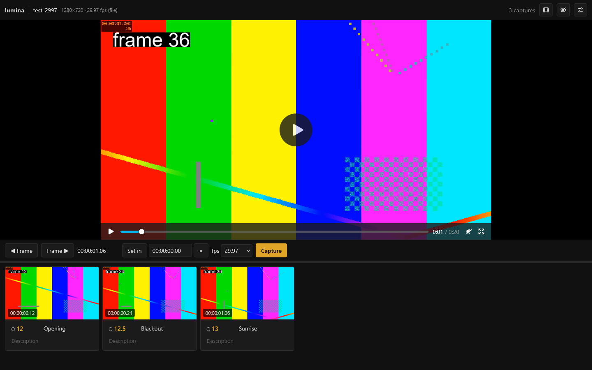
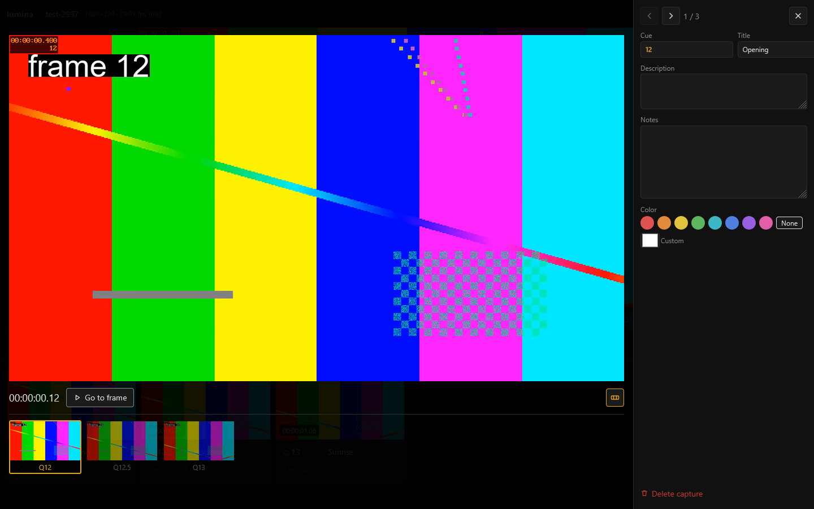

# Capturing

Open https://memoriainfinita.github.io/lumina/ in Chrome or Firefox.

Drop an mp4 on the window, or click the empty stage («Open video»). «Open session» brings back a saved session without the video; see [Cue sheet and sessions](cue-sheet.md).

## Find the moment

- Play and pause with the button on the video or with `K`
- `J` and `L` step back and forward, `←` and `→` move frame by frame; the **◀ Frame** and **Frame ▶** buttons do the same. Reverse playback does not exist in Chrome or Firefox, so `J` steps back frame by frame
- Choose the **fps** of the video if it is not detected; the top bar shows what was found (here 29.97 fps, from the file)
- `I`, or **Set in**, marks the in point: the show time counts from there and starts at 00:00:00.00. The field next to it takes a time by hand, and the × clears it

## Capture

Press `C`, or **Capture**, and the current frame goes to the strip below the video as a card with its time. The counter at the top says how many you have.

Each card has:

- **Q**: the cue number, for example 12.5
- **Title** and **Description**
- A **colour**, from a palette you can edit in Options › Colors
- **Open**, to see it large; **Delete capture**, to remove it

## Make room

Put the captures below or beside the video, and drag the bar between them to resize. `V` hides the video, so you can review the captures full size. The same options are in **Options** › Layout.

## Look closer

**Open** on a card shows the capture large, with its cue, title, description, notes and colour on the right.

- The arrows at the top, or `←` and `→`, go to the previous and next capture
- **Go to frame** takes the video to that moment
- `F` shows or hides the strip of nearby captures
- The notes are for you, and print with the cue sheet
