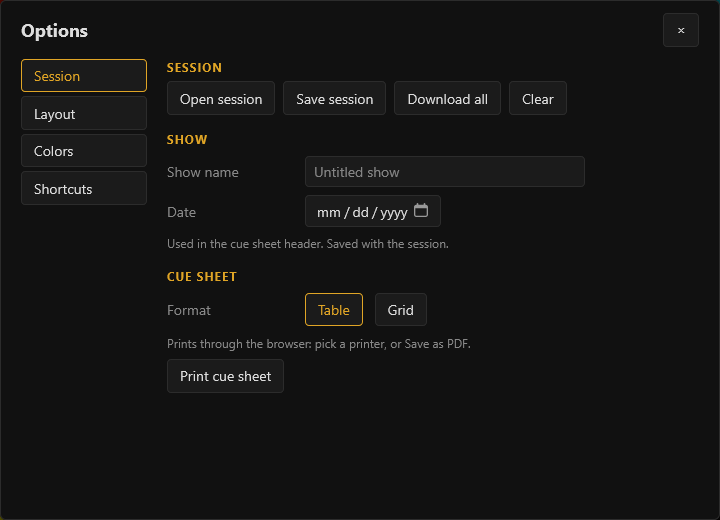

# Cue sheet and sessions

Open **Options** (the button at the top right, or `?`).

## Print a cue sheet

- Fill in **Show name** and **Date**; they go in the header of the cue sheet and are saved with the session
- Choose **Table** or **Grid** and press **Print cue sheet**. It prints through the browser: pick a printer, or Save as PDF

## Download the images

**Download all** gives a zip with every capture, named like `Q012.5_title.jpg`.

## Save and reopen

Captures save themselves in the browser (IndexedDB) and survive a reload. Browser storage can be cleared, and the local file and the live page keep separate storage, so when you finish, press **Save session**: it writes a JSON file, images included. **Open session**, on the start screen or here, brings it back without the video.

**Clear** empties the session.
